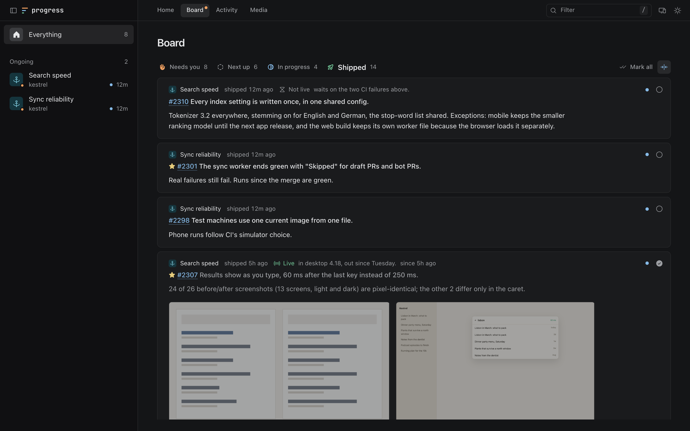
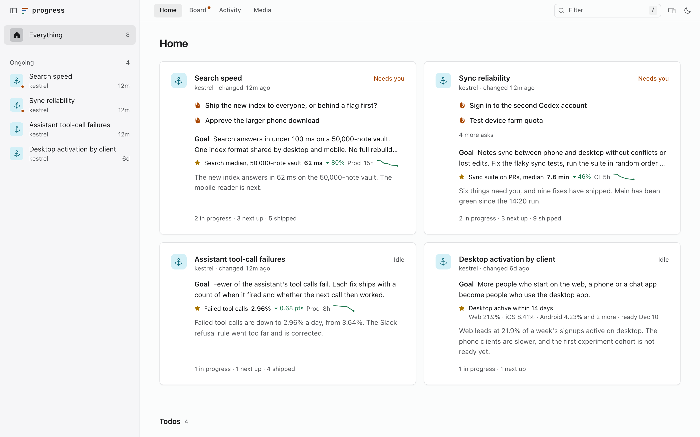
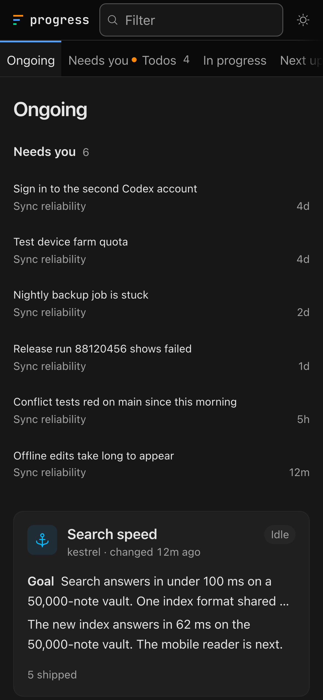
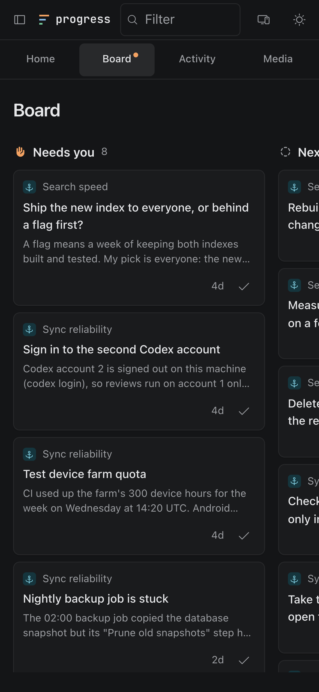

# progress

One page per task your coding agents are working on, and a hub in the browser that shows them all.


When several agents run long tasks at once, it is hard to know which one is waiting for you and what each one finished. Each agent keeps one Markdown page for its task, and the hub shows the pages together. It runs on your machine, with no account.

## What you get

### One board for everything


The board has a column for what needs you, what is planned, what is in progress and what shipped, from all tasks. A dot marks a card that is new since you last looked.

Any column can take the board's whole width, to skim it from top to bottom. Each card is then a row with everything on it: what its page says, its pictures large, whether it is live and its pull requests. The other columns fold into its heading.



### What shipped, and whether it is live


Open a card to read it in full with its pictures, and step to the next one with the arrow keys. A shipped card says whether you can try the change yet, and the hub ticks it as viewed once you have opened it.

### A task's page


A task's page opens with what changed since you last looked. Under that are its goal, what it needs from you, where it stands, and the rest of the page as the agent wrote it.

### Media


This tab shows the screenshots, videos and pages your agents made, from every task, newest first.

### Light and dark

<p>
  
  
</p>

### On your phone

<p>
  
  
  
</p>

The hub runs on your machine and answers only there. To read it on your phone, set up a central hub on your own Cloudflare account: it shows every machine's work at one address, behind a Google sign-in, while the machines sleep.

## Getting started

Give this to your coding agent:

```
Set up https://github.com/triptu/progress-hub on this machine. Follow PROMPT.md in that repo.
```

It installs the hub on macOS or Linux and tells your agents to keep a page for each task. Later, ask the agent to move the pages to another folder, update the hub, or remove it.

Any agent that can run a command can keep a page. With [T3 Code](https://github.com/pingdotgg/t3code), which runs coding agents, the hub also shows each task's agents, their pull requests, and any agent that has stopped to ask you something.
