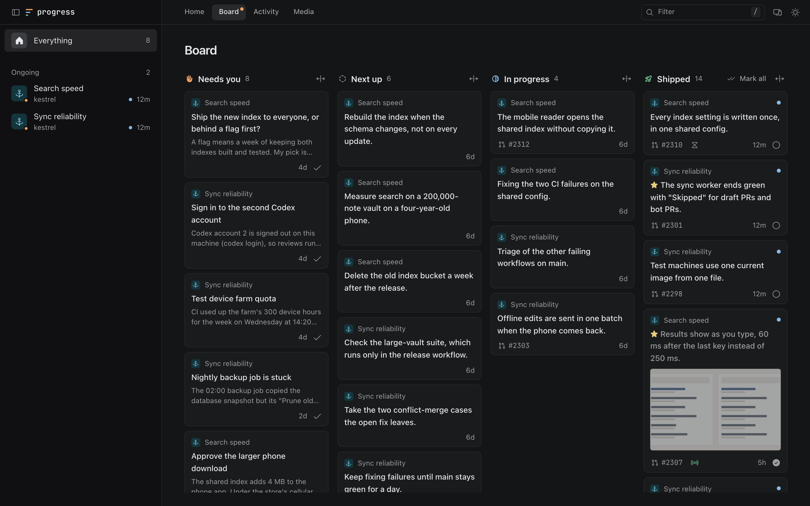
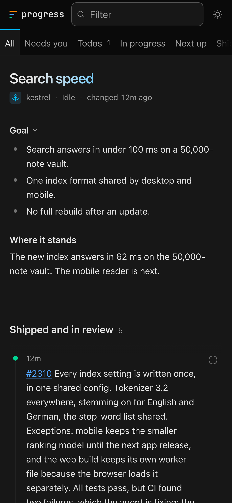

# progress-hub

A centralized progress page where all your agents can put in the work being shipped, in progress and planned, decisions being made, goals, artifacts being created, decisions which need you etc. so you can keep tabs on what your agents are up to from one interface.

<a href="https://progress-hub.tushar.ai/"><picture><source media="(prefers-color-scheme: light)" srcset="docs/trailer-poster-light.jpg"></picture></a>

Website - [progress-hub.tushar.ai](https://progress-hub.tushar.ai).

See what your coding agents are doing, and what they shipped.

Coding agents work on their own, often on several long tasks at once. Each agent keeps one Markdown page for its task. A hub in your browser puts the pages on one board: what shipped, what is in progress, what is next and what needs you. Shipped work comes with the agent's screenshots, its pull requests and whether the change is live.


## Getting started

Give this to your coding agent:

```
Set up https://github.com/triptu/progress-hub on this machine. Follow PROMPT.md in that repo.
```


## What you get

### One board for everything



The board has a column for what needs you, what is planned, what is in progress and what shipped, from all tasks. A dot marks a card that is new since you last looked.

Any column can take the board's whole width. Give it to Shipped to skim everything your agents finished, from top to bottom. Each card is then a row with everything on it: what its page says, its pictures large, whether it is live and its pull requests. The other columns fold into its heading.


### What shipped, and whether it is live


Open a card to read it in full with its pictures, and step to the next one with the arrow keys. A shipped card says whether you can try the change yet, and the hub ticks it as viewed once you have opened it.

### A task's page


A task's page opens with what changed since you last looked. Under that are its goal, what it needs from you, where it stands, and the rest of the page as the agent wrote it.

### Media


This tab shows the screenshots, videos and pages your agents made, from every task, newest first.

### Light and dark

<p>
  
  
</p>

### On your phone

<p>
  
  
  
</p>

The hub runs on your machine and answers only there. To read it on your phone, set up a central hub on your own Cloudflare account: it shows every machine's work at one address, behind a Google sign-in, while the machines sleep.


