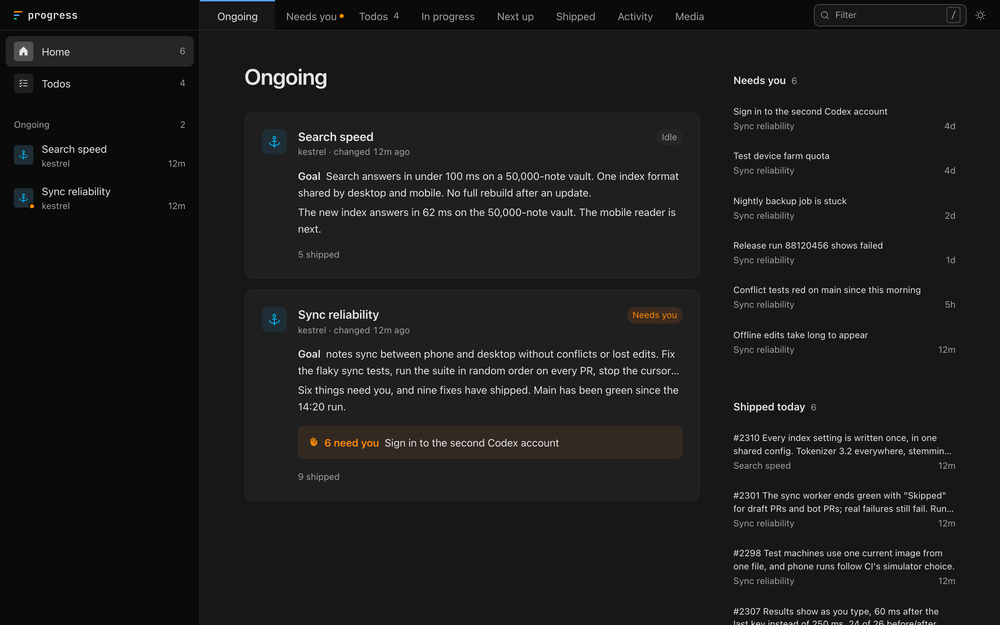
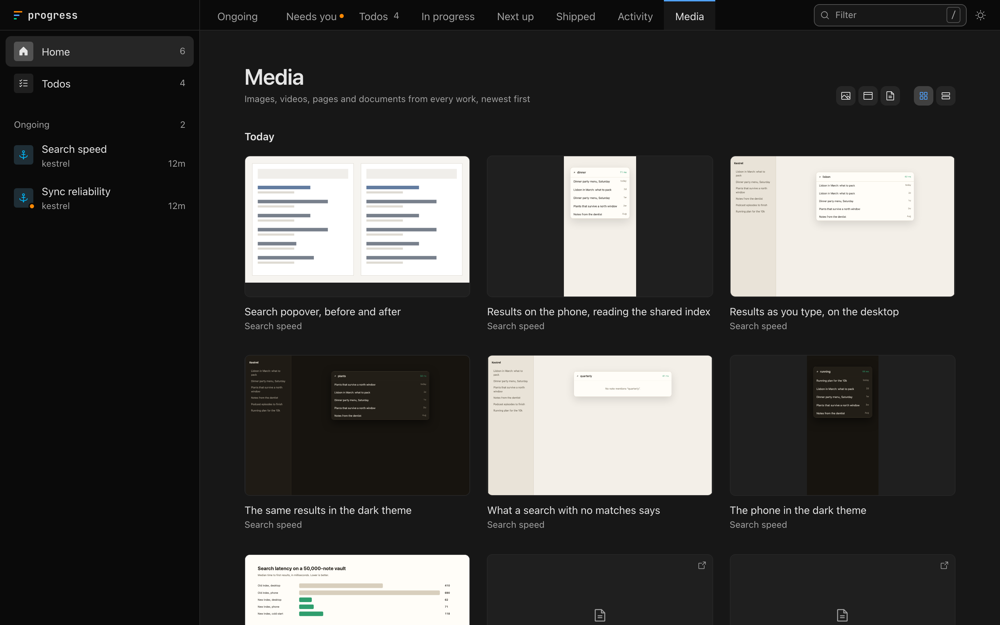
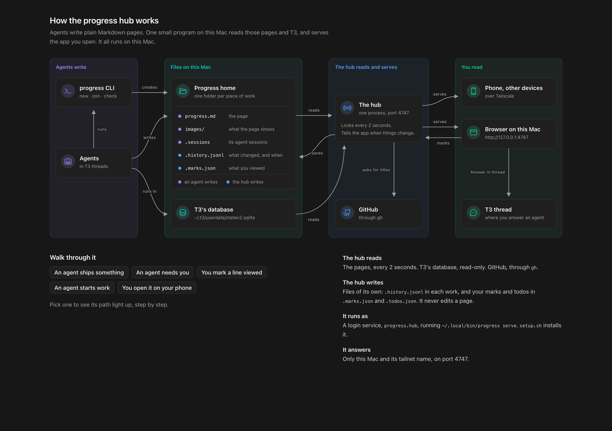

# progress

One Markdown page per piece of agent work, and a hub in the browser that shows all of them.



When several coding agents run long tasks at once, each task keeps one page: where it stands, what it needs from you, what is in progress, what is next, what was decided and what shipped. The agent writes the page as plain Markdown. The hub reads every page and shows them together, so you can see what needs you across everything and be back in context on any one of them in seconds.

## Install

```bash
git clone https://github.com/triptu/progress-hub
cd progress-hub
bash setup.sh
```

Setup needs [Bun](https://bun.sh). It builds one program, `progress`, and puts it in `~/.local/bin`, which must be on the `PATH` your agents start with.

- **On macOS** it also runs the hub as a login service, so http://127.0.0.1:4747 is there after every restart.
- **On Linux** start the hub yourself with `progress serve`. Windows is not tested.
- **Where pages are kept.** In `~/progress`. To keep them somewhere else, run `PROGRESS_HOME=/some/folder bash setup.sh`.
- **Optional.** With `gh` signed in, a shipped line that links a pull request shows its title and state. With Tailscale and `jq`, setup also makes the hub reachable from your phone and other machines on your tailnet.

To look before installing, `bun install && bun run demo` serves the sample pages in `test/pages` on http://127.0.0.1:4748.

## Your first page

```bash
progress new "Search speed"
```

This makes `~/progress/search-speed/progress.md` and prints its path and its link in the hub. The page starts with the headings the hub reads as lists, and everything else on it is drawn as written:

```markdown
---
title: Search speed
---

The new index answers in 62 ms. The mobile reader is next.

## Goal

- Search answers in under 100 ms on a 50,000-note vault.

## Needs you

### Ship the index behind a flag, or to everyone?
The flag costs a week of two code paths. My pick is everyone, because the old index is slower in every case measured.

## Shipped

- ! Search went from 410 ms to 62 ms. https://github.com/kestrel-labs/kestrel/pull/2302
```

`progress check search-speed` says what the hub read from a page and anything it could not read. `FORMAT.md` is the whole format.

## Tell your agents

Agents keep the pages, so they need to know the pages exist. Put this in the instructions your agents read (`CLAUDE.md`, `AGENTS.md`):

```
For any task I will come back to, run `progress new "<title>"` when you start, and keep the page it
prints current as you work. Run `progress format` once to read the page format.
```

## What the hub shows

- **Home and each work share one set of tabs.** On Home they cover everything: ongoing work, what needs you, what is in progress, what is next, what shipped, activity and media. Open a work and the same tabs narrow to it, with the first one showing its whole page.
- **Ongoing and Settled.** Work is settled when its page says done or when every one of its sessions is settled in its harness. Settled work folds away at the foot of the sidebar, and what it still lists under Needs you can be dismissed.
- **A feed that shows what matters.** What needs you and what a page marks with `!` stand out, and small updates fold into one line.
- **Filters where the list is.** Activity narrows to kinds of change, Shipped to what is not viewed or what is important, and Media to images, videos, pages or documents. Media also switches between a gallery and one to a row.
- **A viewer for what a page shows.** A picture, video or page opens large over the screen you were on. A click on a picture shows it at full size to drag around, and the arrow keys move through the list.
- **Viewed marks on what shipped.** Each shipped line has a ring to click once you have looked at it, so you know which merged pull requests you have been through. The Shipped tab counts what is left and can show only that. The hub keeps the marks in `.marks.json` in the progress home, so every device shows the same.
- **Todos.** Your own list of things to do later, on a tab of its own and one click from the sidebar. One line adds a todo (`N` goes to it), a click on its words edits it in place, and it may have a description. It can be linked to a work or a project: picked from a menu, or by typing `@` or `/` and its name in the words. A deleted todo can be put back. A work's tab lists its own, and a todo about a work says when that work has settled. An agent adds one with `progress todo "<text>"`. The hub keeps the list in `.todos.json` in the progress home.
- **Where to try it.** The links a page lists under `Try it` (a dev server, a preview, an HTML file) are buttons on the work and on Home, with a dot that says whether the server answers.
- **Artifacts in one place.** A page, video or document a work made and linked from its page is listed beside the page, and on Media.
- **A work's page.** A heading per section, an outline that follows the scroll, and a mark on what is new since you last opened it.
- **Light and dark.** The hub follows your system. The button at the right end of the top bar switches to the other look, and the browser remembers it.




## Harnesses

With no harness, the hub shows the pages and everything built from them: what needs you, the plan, what shipped, the feed, media and todos. With one it also shows each work's agents and whether they are working, their pull requests, any agent stopped on a question, and it settles a work when its sessions are over.

The hub reads agents through one small interface, `AgentSource` in `src/sources/source.ts`: which session a command runs in, what the harness knows about a list of sessions, and the link that opens one. T3 Code is the one adapter today (`src/t3/`), found with no setup when the hub starts on a machine T3 has run on. Another harness is one adapter file and a line in `src/sources/index.ts`. A work lists its sessions as `<harness>:<id>` in `.sessions`, so one work can have agents from several harnesses. The page format knows nothing about any of them.

## Where works are kept

The hub reads works through one small interface, `WorkStore` in `src/stores/store.ts`: the store's state, one work's page, its media, and a file. The default is `DiskStore` (`src/stores/disk/`), the progress home on this machine, which needs nothing but a folder. Another machine's hub is a second store (`src/stores/remote.ts`). The server and the app know only the interface.

A store answers with finished state: pages already rendered, with what needs you, the plan and the feed worked out, and with its own id leading each work's id. So another store is something that can do that work or be handed it, such as a hub running on a server that machines send their state to. It is added where the hub is started, in `src/main.ts`. A store of raw pages in a bucket would be a different seam, under `src/stores/disk/pages.ts`, and is not built.

Your viewed marks and your todos are two files the hub keeps in the progress home.

## Styles

Each view's styles are in a CSS Module beside it: `src/web/views/Feed.module.css` for `Feed.tsx`. A class in a module belongs to that view alone, so two views can use the same word for two things. Three rules keep it that way:

- **A class is a name.** `row`, `viewed` and `ghost` are classes of the view that uses them.
- **A value is an attribute.** A work's phase, a line's weight or kind, a size and a status are written as `data-phase`, `data-weight` and so on, and a state the element already says for assistive tools is read from there (`aria-current`, `aria-pressed`).
- **A name is shared only when `src/web/css/` styles it.** Those files hold the app's frame, the pieces every view is built from (`btn`, `avatar`, `when`) and the prose a page renders. A module names a shared class as `:global(.btn)`, and only tied to one of its own classes.

The page's linked styles come before the modules in the bundle, so a module's rule wins a tie with a shared one. `bun run css-types` writes each module's types after its classes change. A class a view names that its module lacks is then a type error, and the tests fail on a class no view names.

## Other machines

Each machine runs its own hub, which reads its own pages and harnesses. The hub you open also reads the hubs of your other machines and shows their work beside its own, named by machine. It finds them from the machines a harness is linked to (T3's linked environments), on the same port, and from `PROGRESS_PEERS` (`Box=http://box.tailnet.ts.net:4747`, separated by commas). A machine that stops answering keeps showing what it last sent. Run `setup.sh` on a machine to give it a hub.

## How it works

Agents write the pages. One small program on your machine reads them and, when you use T3 Code, its database, and serves the app. [docs/how-it-works.html](docs/how-it-works.html) is this picture with flows you can walk through.



`setup.sh` installs the hub as a login service and, with Tailscale, makes it reachable from your other devices. `FORMAT.md` is the page format, and `progress --help` lists the commands.

## Working on it

```bash
bun install
bun run dev      # the hub on your own pages, reloading as you edit
bun run demo     # the hub on the sample pages, on port 4748
bun run check    # types
bun test
```

## Licence

MIT. See `LICENSE`.
