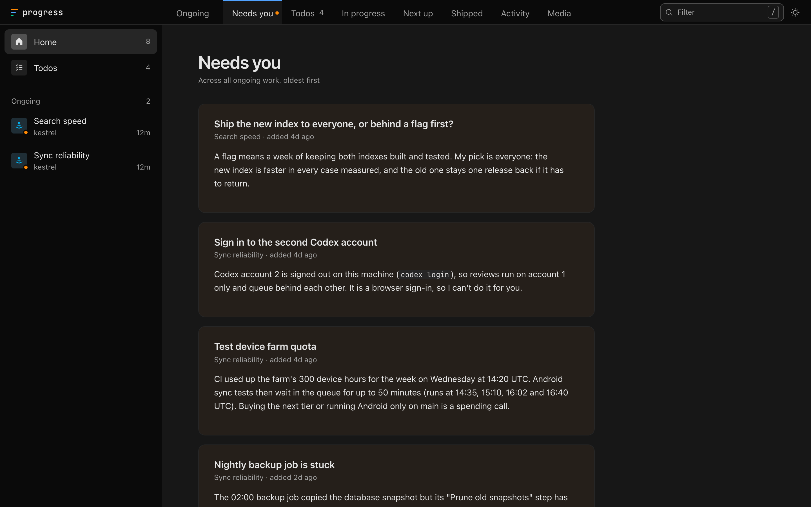
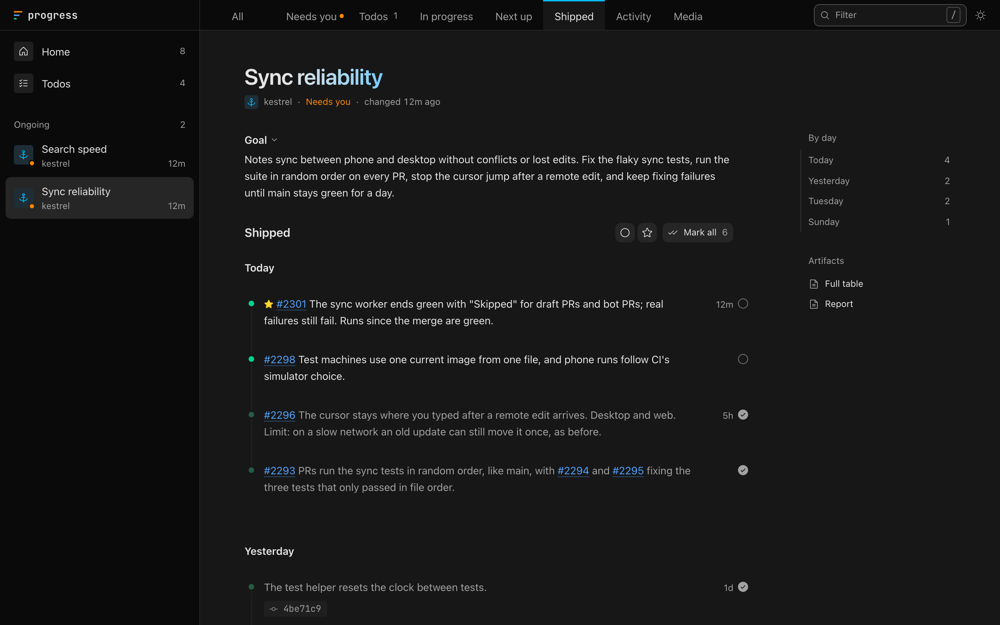
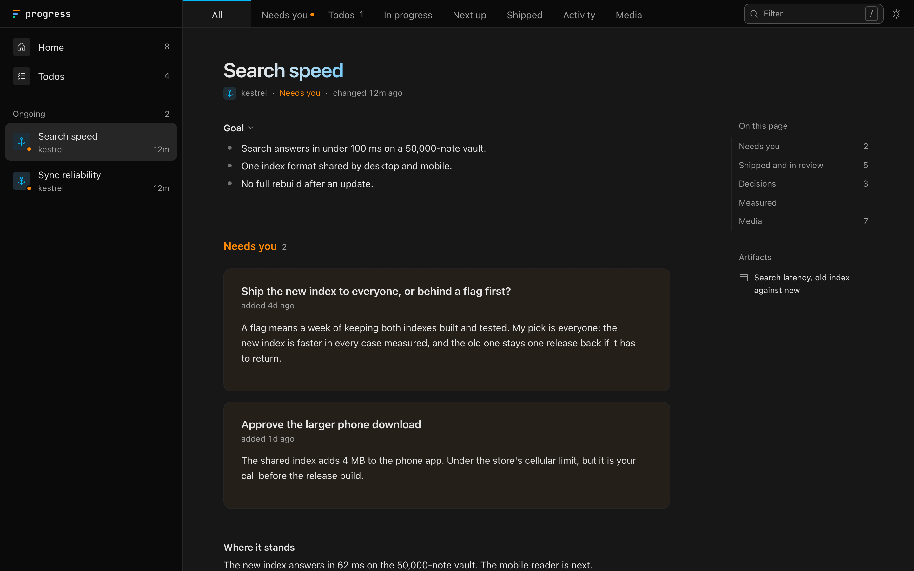
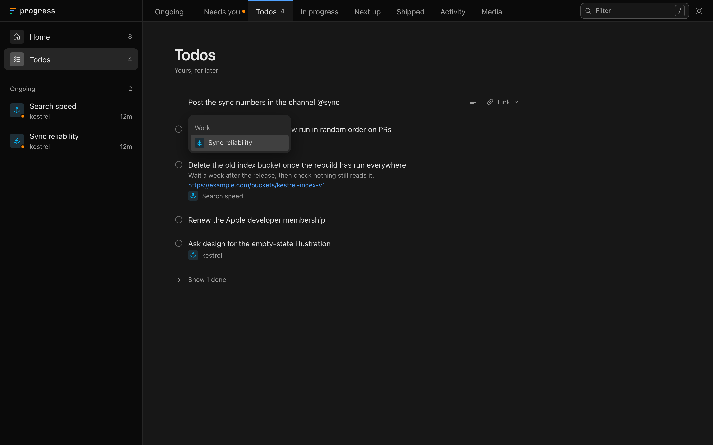

# progress

One page per task your coding agents are working on, and a hub in the browser that shows them all.


When several agents run long tasks at once, it is hard to know which one is waiting for you and what each one finished. Each agent keeps one Markdown page for its task, and the hub shows the pages together. It runs on your machine, with no account.

## What you get

### What needs you



This tab lists every question and blocker your agents have written down, from all tasks, with the one that has waited longest on top.

### What shipped



This tab lists what each task finished, by day, with a link to its pull request. Tick a line once you have looked at it, and the Mark all button counts the ones you have not.

### A task's page



The hub shows the page as the agent wrote it, with its goal, where it stands, its decisions and its pictures. An outline marks the section you are reading, and a dot shows what is new since you last opened it.

### Media


This tab shows the screenshots, videos and pages your agents made, from every task, newest first.

### Todos



This is your own list of things to do later. Type `@` and a task's name to link a todo to it, and the todo says when that task is over.

### Light and dark

<p>
  
  
</p>

### On your phone

<p>
  
  
  
</p>

On a Mac with Tailscale, setup makes the hub reachable from your phone and your other machines.

## Getting started

Give this to your coding agent:

```
Set up https://github.com/triptu/progress-hub on this machine. Follow PROMPT.md in that repo.
```

It installs the hub on macOS or Linux and tells your agents to keep a page for each task. Later, ask the agent to move the pages to another folder, update the hub, or remove it.

Any agent that can run a command can keep a page. With [T3 Code](https://github.com/pingdotgg/t3code), which runs coding agents, the hub also shows each task's agents, their pull requests, and any agent that has stopped to ask you something.
