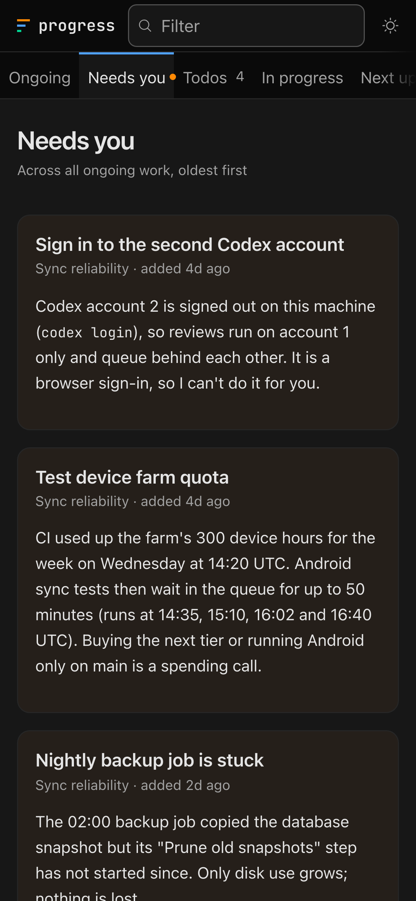

# progress

One page per task your coding agents are working on, and a hub in the browser that shows them all.


When several agents run long tasks at once, it is hard to know which one is waiting for you and what each one finished. Each agent keeps one Markdown page for its task, and the hub shows the pages together. It runs on your machine, with no account.

## What you get

### What needs you


Every question and blocker your agents have written down, from all tasks, with the one that has waited longest on top.

### What shipped


What each task finished, by day, with a link to its pull request. Tick a line once you have looked at it, and the tab counts the ones you have not.

### A task's page


The page as the agent wrote it, with its goal, where it stands, its decisions and its pictures. An outline follows the scroll, and a mark shows what is new since you last opened it.

### Media


The screenshots, videos and pages your agents made, from every task, newest first.

### Todos


Your own list of things to do later. Type `@` and a task's name to link a todo to it, and the todo says when that task is over.

### Light and dark

<p>
  
  
</p>

The hub follows your system's theme, and a button in the top bar switches it.

### On your phone

<p>
  
  
  
</p>

On a Mac with Tailscale, setup makes the same hub open on your phone and your other machines.

## Getting started

Give this to your coding agent:

```
Set up https://github.com/triptu/progress-hub on this machine. Follow PROMPT.md in that repo.
```

It installs the hub on macOS or Linux and tells your agents to keep a page for each task. To keep the pages in another folder, update the hub or remove it, ask the agent.

Any agent that can run a command can keep a page. With T3 Code, the hub also shows each task's agents, their pull requests, and any agent that has stopped on a question.
