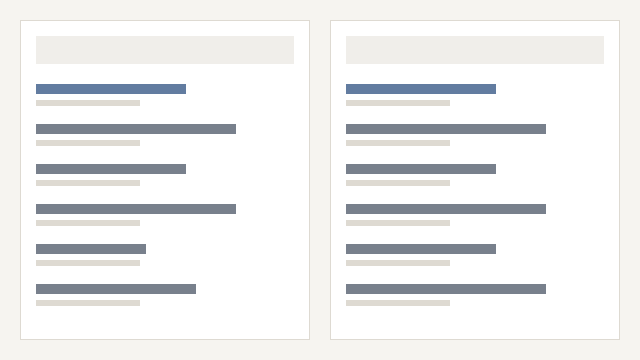
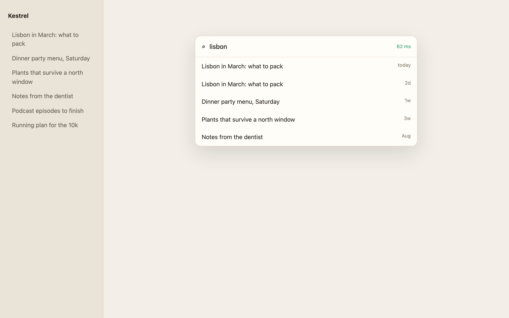
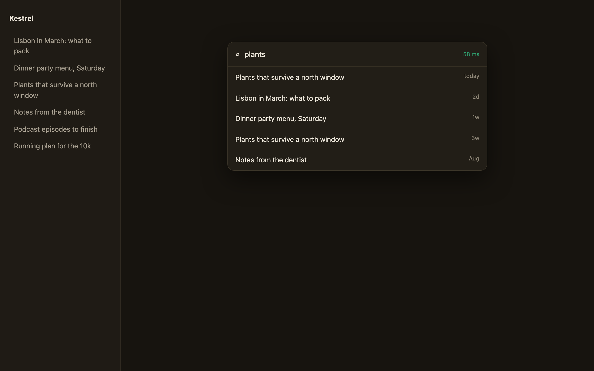
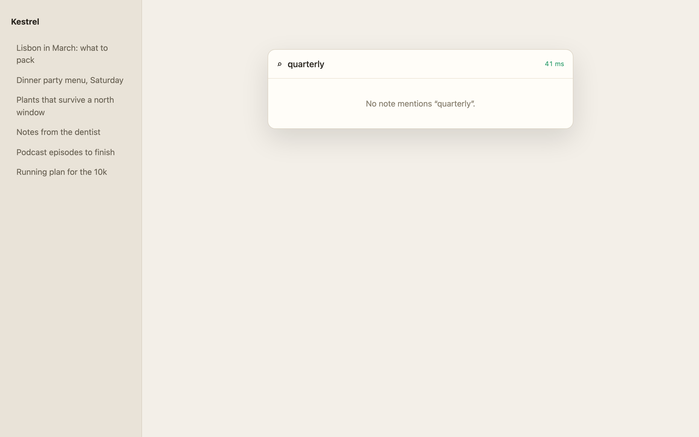

The new index answers in 62 ms on the 50,000-note vault. The mobile reader is next.

## Goal

- Search answers in under 100 ms on a 50,000-note vault.
- One index format shared by desktop and mobile.
- No full rebuild after an update.

## Needs you

Nothing right now.

## Shipped and in review

- https://github.com/kestrel-labs/kestrel/pull/2310 Every index setting is written once, in one shared config. Tokenizer 3.2 everywhere, stemming on for English and German, the stop-word list shared. Exceptions: mobile keeps the smaller ranking model until the next app release, and the web build keeps its own worker file because the browser loads it separately. All tests pass, but CI found two failures, which the agent is fixing: the German stemmer splits compound words differently, and one snapshot test sorts ties in a new order.
- https://github.com/kestrel-labs/kestrel/pull/2307 Results show as you type, 60 ms after the last key instead of 250 ms. 24 of 26 before/after screenshots (13 screens, light and dark) are pixel-identical; the other 2 differ only in the caret.

  
  
  
  
  
  

  The numbers are in [Search latency, old index against new](images/latency.html).
- https://github.com/kestrel-labs/kestrel/pull/2304 The index is updated in place after an edit. With https://github.com/kestrel-labs/kestrel/pull/2305 and https://github.com/kestrel-labs/kestrel/pull/2306: about 400 call sites now pass the changed note instead of asking for a rebuild, so opening the app after an update no longer reindexes everything.
- https://github.com/kestrel-labs/kestrel/pull/2302 Search on mobile reads the same index format as desktop. Search median on the 50,000-note vault went from 310 ms to 84 ms, but the phone was warmer during the "before" runs.
- https://github.com/kestrel-labs/kestrel/pull/2299 `ripsearch` listed only at the root, and CI fails when a package pins its own copy. https://github.com/kestrel-labs/kestrel/pull/2297 (mira-k's) merged too.

## Decisions

- Ranking keeps exact title matches first, then recency, because people search for a note they remember the name of. Chose this over pure relevance after the first test round. Flip it if you want relevance first.
- One index format for desktop and mobile. You chose this.
- The old index is deleted after the first successful rebuild, not kept as a fallback, because keeping both doubled the disk use on phones. You chose this.

## Measured

| Vault size | Before | After |
|---|---|---|
| 5,000 notes | 48 ms | 12 ms |
| 50,000 notes | 310 ms | 84 ms |
| 200,000 notes | 1,420 ms | 390 ms |
